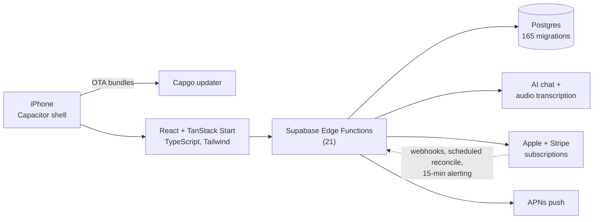

# Brie Wieselman, L.Ac.

**Clinician who builds clinical AI.**

I spent my career in clinical practice. Now I build the systems: a shipped iOS app, multi-agent pipelines, and the guardrails that keep a human in charge of anything that reaches a real person.

---

## Aliza: AI health coach for iOS

**Live on the [App Store](https://apps.apple.com/us/app/aliza-health/id6812247110)** · [aliza.health](https://aliza.health) · source is private

I designed, built, and ship it myself. It coaches; it does not replace care.

What's under the hood:

- **Two payment systems, one source of truth.** Apple and Stripe subscriptions are verified server-side, then reconciled on a schedule. A 15-minute job emails me when a webhook fails or never arrives.
- **Over-the-air releases.** Web-layer fixes ship through Capgo without a new binary; native changes go through App Store review.
- **Tested like it matters.** Vitest for logic, Playwright for flows, Sentry for crashes, PostHog for what people actually do.

---

## Websites

Designed and built by me with AI coding agents. Click any clip to open the live site.

**[Walk the Path](https://walk.aliza.health)**: a scroll-driven film for Aliza. Each scroll step is a scene; the copy and the jungle build together. GSAP ScrollTrigger + Lenis.

**[localcurrent.ai](https://localcurrent.ai)**: my design studio's site. A WebGL river opens the page and carries you through it.

**[aliza.health](https://aliza.health)**: the Aliza sales site, from first question to App Store.

**[Last Line](https://lastline.localcurrent.ai)**: a free web app that writes short-form video scripts in your own voice. Hook-first pipeline with a built-in self-audit; runs on your own Gemini key.

Full-quality clips: [Walk the Path](media/walk-the-path.mp4) · [localcurrent.ai](media/localcurrent.mp4) · [aliza.health](media/aliza-home.mp4)

---

## Open source

| Repo | What it does |
|---|---|
| [**content-machine**](https://github.com/brie-wieselman/content-machine) | Multi-agent content engine: research, draft, voice-grade, then a hard human approval gate before anything publishes. Bring your own brand config. |
| [**voiceprint**](https://github.com/brie-wieselman/voiceprint) | Extracts a person's real writing voice from evidence: 12 structural dimensions, checkable rules instead of adjectives, plus a pass/fail test for any draft. |
| [**avatar-video-pipeline**](https://github.com/brie-wieselman/avatar-video-pipeline) | One Claude skill that turns a script into an avatar video: ElevenLabs voice, HeyGen render, your own credentials. |

---

## How I build

The machine does the labor. The human keeps the judgment.

In practice that means rendering is never publishing, every automated output has a named approval step, and a change isn't done until I've watched it work in the real app. Most of my code is written with AI agents (Claude Code); the architecture, the guardrails, and the decisions are mine.

---

[aliza.health](https://aliza.health) · [briewieselman.com](https://briewieselman.com)

I learned to build by building. The clinic taught me what to build.
